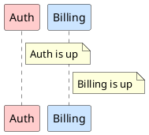

# luaj (PlantUML edition)

A small, sandboxed Lua 5.2 interpreter written in pure Java, derived from
[Luaj2](https://github.com/malfact/luaj) (itself a fork of the original
[LuaJ](https://github.com/luaj/luaj)). It is meant to be embedded in
[PlantUML](https://plantuml.com), **not** to be a general-purpose Lua
platform.

The license is unchanged (see `LICENSE`).

## 1. What we are trying to do

PlantUML ships in several editions that must behave identically: the regular
JAR, a JavaScript build and a native C build, the last two produced with
[TeaVM](https://teavm.org). We want Lua inside PlantUML to:

- **drive PlantUML from Lua** (build a model, call layout/render functions,
  query the result);
- **generate diagrams from Lua code embedded in the diagram source**, partly
  replacing the text preprocessor (loops, functions, data structures).

Because the Java edition must have the same Lua as the C edition, Lua is
implemented **in Java**: one interpreter, compiled to JVM bytecode, JavaScript
and C. Hence the constraints that drive every decision in this fork:

- no reflection, no threads, no file system, no `Class.forName`;
- nothing that TeaVM cannot compile;
- no uncatchable failures (a `StackOverflowError` crashes a TeaVM/C binary);
- the smallest possible surface: what is not needed is removed.

### Sketch of the future syntax (not implemented yet)

Lines starting with `$ ` are Lua. `${expr}` interpolates a Lua value into a
PlantUML line. Every line of a function body carries the `$` prefix, like the
`!` repeated in the current preprocessor:

```plantuml
@startuml
$ services = { "Auth", "Billing", "Catalog", "Search" }

$ function color(name)
$   if name == "Auth" then
$     return "#FFCCCC"
$   end
$   return "#CCE5FF"
$ end

actor User

$ for i, s in ipairs(services) do
participant "${s}" as ${s} ${color(s)}
$ end

$ for i, s in ipairs(services) do
User -> ${s} : request ${i - 1}
$ end
@enduml
```

Indentation after `$ ` is free and only matters for readability. The prefix
is heavy for a long block, so a delimited variant is also considered. `$$`
opens and closes a multi-line Lua block, again detected by its prefix (no
`@lua` keyword needed), while `$ ` stays for single lines (loops, conditions
around PlantUML text). The two notations can coexist:

```plantuml
@startuml
$ services = { "Auth", "Billing", "Catalog", "Search" }

$$
function color(name)
  if name == "Auth" then
    return "#FFCCCC"
  end
  return "#CCE5FF"
end
$$

actor User

$ for i, s in ipairs(services) do
participant "${s}" as ${s} ${color(s)}
$ end
@enduml
```

### Procedures

In the current preprocessor a *function* returns a value, while a
*procedure* emits PlantUML lines:



Two candidate replacements. Both are drafts.

**A. Plain Lua function calling an `emit()` primitive.** Nothing new in the
syntax; the function body is ordinary Lua, and `emit` appends a line to the
generated text.

```plantuml
@startuml
$ function service(name, color)
$   emit("participant " .. name .. " " .. color)
$   emit("note right of " .. name .. " : " .. name .. " is up")
$ end

$ service("Auth", "#FFCCCC")
$ service("Billing", "#CCE5FF")
@enduml
```

The same with a `$$` block, which keeps long bodies readable:

```plantuml
@startuml
$$
function service(name, color)
  emit("participant " .. name .. " " .. color)
  emit("note right of " .. name .. " : " .. name .. " is up")
end
$$

$ service("Auth", "#FFCCCC")
$ service("Billing", "#CCE5FF")
@enduml
```

**B. `$ procedure` / `$ end`: a body made of PlantUML lines.** Lines without
the `$` prefix are emitted (with `${}` interpolation), lines with `$` are Lua.
This is the closest to `!procedure`, and it makes the difference between a
function (returns a value) and a procedure (emits text) visible in the syntax:

```plantuml
@startuml
$ procedure service(name, color)
participant ${name} ${color}
note right of ${name} : ${name} is up
$ end

$ service("Auth", "#FFCCCC")
$ service("Billing", "#CCE5FF")
@enduml
```

A procedure may mix both kinds of lines, call other procedures and loop:

```plantuml
@startuml
$ procedure stack(names)
$   for i, n in ipairs(names) do
participant ${n}
$     if i > 1 then
${names[i - 1]} -> ${n}
$     end
$   end
$ end

$ stack({ "Web", "API", "DB" })
@enduml
```

Compared with `!procedure`: arguments are real Lua values (numbers, tables,
booleans) rather than text, so no `$name` substitution rules and no quoting
problems; recursion is allowed (up to `maxCallDepth`).

The APIs the two kinds of Lua would see are sketched in section 2 below; none of it is implemented.

## 2. Two Lua flavors

There would be **two different uses of Lua in PlantUML**. They share the same
interpreter (this library) but are configured differently, they run
independently, and they never see each other's API.

| | **Text Lua** (inside a diagram) | **Engine Lua** (driving the engine) |
|---|---|---|
| Purpose | generate or transform PlantUML source text, replacing much of the preprocessor | run PlantUML as a library: parse, lay out, render, many diagrams per run |
| Where it lives | in the `.puml` file, on `$` / `$$` lines | in a standalone `.lua` script given to the executable |
| Editions | all: JAR, JavaScript, C | **JAR and C only**, never in the browser |
| Lifetime | one fresh `Globals` per diagram, thrown away afterwards | long-lived, serves many diagrams |
| I/O | none; resources only through `Globals.finder`, under PlantUML's security profile | decided by the host: files, console, exit code |
| Determinism | mandatory (same output on every edition) | not required |
| Limits | strict (call depth, later instruction count and memory) | looser |
| Errors | reported on the diagram line, like preprocessor errors | stack trace on the console |
| Main API | `puml.*` | `plantuml.*` |

The two compose in one direction only: engine Lua calls `plantuml.render`,
which starts a fresh text Lua for each diagram it renders. Text Lua can never
call `render`, so a diagram cannot start renders of its own, and the two
states never share anything except the data the engine passes in
(`args`). On a server, only the text flavor is exposed.

This library stays generic (a Lua interpreter and its standard libraries).
The `puml` and `plantuml` libraries belong to the PlantUML code base, which
hands a configured `Globals` to the interpreter.

Everything in this section is a design sketch.

### 2.1 Text Lua: the `puml` API

Values exchanged are plain Lua values (strings, numbers, booleans, tables).
No Java objects are exposed.

Level 0, generate text (essential):

- `puml.emit(line)` appends a line to the generated source; `emit` may also
  exist as a global alias.
- `puml.quote(s)` quotes and escapes a string.
- `puml.id(s)` builds a valid PlantUML identifier from any string (accents,
  spaces, dashes).
- `puml.error(msg)` raises an error attached to the current diagram line.
  Plain Lua errors also carry the right line number.

Level 1, read the environment:

- `puml.version`, `puml.edition` (`"jar"`, `"js"` or `"c"`).
- `puml.args`: the variables given on the command line, as a table (and, for
  the engine, the `args` passed to `plantuml.render`).

Level 2, data:

- `puml.json.decode` / `puml.json.encode` (`%load_json` is a common use of
  the current preprocessor).
- `puml.read(name)` loads a text or JSON resource through `Globals.finder`,
  with the same rules and security profile as `!include`. There is no direct
  disk access from text Lua.
- `require` for Lua modules shipped as resources (stdlib), through the same
  finder.

Other rules: one `Globals` per diagram, shared with its `!include`d files;
no clock, and `math.random` seeded per diagram, so a diagram renders the
same on every edition.

Not planned: introspecting the laid-out model (positions, sizes of
participants). It would freeze PlantUML's internals into a public API.

### 2.2 Engine Lua: the `plantuml` API

The host provides files, rendering and arguments:

- `plantuml.render(source, options)` returns the result (a string for SVG and
  text formats, bytes for PNG) or raises an error with details. Options:
  `format`, `theme`, `args` (passed to the text Lua of that diagram).
- `plantuml.read(path)`, `plantuml.write(path, data)`,
  `plantuml.glob(pattern)`, `plantuml.list(dir)`, `plantuml.mtime(path)`.
- `plantuml.args`: command line arguments of the script.
- A way to exit with a status code, and `print` to the console. The `os` and
  `io` libraries are removed from this library; whatever the engine flavor
  needs is provided by `plantuml.*`.

Examples (sketches; none of this exists yet).

**Batch rendering of a folder.** One startup instead of one JVM per file:

```lua
for _, f in ipairs(plantuml.glob("docs/**/*.puml")) do
  local out = f:gsub("%.puml$", ".svg")
  plantuml.write(out, plantuml.render(plantuml.read(f), { format = "svg" }))
  print("ok", out)
end
```

**Incremental rendering**, only what changed:

```lua
for _, f in ipairs(plantuml.glob("docs/**/*.puml")) do
  local out = f:gsub("%.puml$", ".png")
  if plantuml.mtime(f) > (plantuml.mtime(out) or 0) then
    plantuml.write(out, plantuml.render(plantuml.read(f), { format = "png" }))
  end
end
```

**One diagram, several variants:**

```lua
local src = plantuml.read("architecture.puml")
for _, theme in ipairs({ "plain", "cerulean", "sketchy" }) do
  plantuml.write("out/architecture-" .. theme .. ".svg",
    plantuml.render(src, { format = "svg", theme = theme }))
end
```

**Passing parameters to the text Lua of a diagram.** The engine script
prepares values that the diagram's own `$` lines read from `puml.args`:

```lua
local envs = { prod = { "web", "api", "db" }, staging = { "web", "api" } }
for name, services in pairs(envs) do
  plantuml.write("out/" .. name .. ".svg",
    plantuml.render(plantuml.read("deploy.puml"), {
      format = "svg",
      args = { env = name, services = services },
    }))
end
```

and in `deploy.puml`:

```plantuml
@startuml
$ for _, s in ipairs(puml.args.services) do
node "${s}"
$ end
@enduml
```

**Documentation pipeline.** Extract the diagram blocks of a Markdown file,
render them and replace each block by an image link:

````lua
local md = plantuml.read("guide.md")
local n = 0
md = md:gsub("```plantuml\n(.-)```", function(code)
  n = n + 1
  local name = "img/guide-" .. n .. ".svg"
  plantuml.write(name, plantuml.render(code, { format = "svg" }))
  return ""
end)
plantuml.write("guide.out.md", md)
````

**Regression tests:**

```lua
local failed = 0
for _, f in ipairs(plantuml.glob("tests/*.puml")) do
  local svg = plantuml.render(plantuml.read(f), { format = "svg" })
  local ref = f:gsub("%.puml$", ".svg")
  if svg ~= plantuml.read(ref) then
    failed = failed + 1
    print("DIFF", f)
  end
end
plantuml.exit(failed == 0 and 0 or 1)
```

**A diagram built from the state of the file system.** Here the engine builds
the source text itself, which text Lua would do with `emit`:

```lua
local lines = { "@startuml" }
for _, dir in ipairs(plantuml.list("src")) do
  lines[#lines + 1] = ('package "%s" {\n}'):format(dir)
end
lines[#lines + 1] = "@enduml"
plantuml.write("structure.svg",
  plantuml.render(table.concat(lines, "\n"), { format = "svg" }))
```

**A project file.** A `plantuml.lua` at the root of a project could list the
diagrams, their formats and a shared theme, and the engine script would build
everything, like a `Makefile` but in a language the user already knows.

Most of these are tasks people already do with shell scripts around PlantUML.
The gain would be one tool, one startup, and the same script on Windows
and Linux.

## 3. Where we are

Branch `plantuml1`. The library has been stripped and hardened, but it is
still "LuaJ minus things"; nothing PlantUML-specific exists yet.

Removed:

- coroutines (`LuaThread`, `CoroutineLib`, the thread type);
- `debug` library and the hooks in the interpreter loop;
- `io` and `os` libraries and every file-system access;
- `luajava`/coercion, `luajc` (bytecode generation), the JSR-223 script engine,
  the AST/parser modules, the server, obsolete examples;
- reflection in `LibFunction.bind` (now takes a `Supplier`);
- Java ME leftovers: `JseMathLib` and `JseStringLib` are merged into
  `MathLib` and `StringLib`;
- `String.format` (`%e/%f/%g` are formatted by `StringLib` itself, with exact
  half-even rounding through `BigDecimal`, like C `printf`).

Added or changed:

- **Call depth limit**: `Globals.maxCallDepth` (default 200). Infinite
  recursion raises a catchable `LuaError("stack overflow")`. Tail calls are
  not counted.
- **Sandbox model**: no scripts or modules are found on disk. `require` and
  `loadfile` go through the `Globals.finder` (`ResourceFinder`) installed by
  the host.
- **Java 11** is the language level (shared with the TeaVM builds).
- **Lua 5.2 conformance fixes** (`Lua52CompatibilityTest`): numbers are
  converted to strings like the reference `"%.14g"` (`NumberFormatter`, exact
  and identical on every edition, no `Double.toString`); `tonumber` accepts
  what C does (white space, signs, hexadecimal floats) and returns `nil`
  instead of failing on `0x`; `string.format("%s")` honors `__tostring` and
  accepts any value, and `%5s`, `%-5s`, `%.3s`, `%5c` apply width and
  precision; `1/-0.0` is `-inf`; `_VERSION` is `"Lua 5.2"`.
- Tests: 214 of 225 pass; the 11 failures are known and pre-existing (see
  below).

Runtime dependencies: none (JDK only). Test dependency: JUnit 5.

## 4. What remains to do / to clean

Cleaning:

- `CompatibilityTest`: its reference outputs and directory are missing. Revive
  it against a real `lua5.2` and fix its base directory (all 11 known
  failures).
- `lua.java` and `luac.java` (command-line tools) still use `System.*`,
  `Class.forName(...).newInstance()` and files. Move them to tests/tools or
  delete them.
- The `core` and `jse` source directories are merged (`src/main/java`).
  `JsePlatform` is the only piece that really belongs to "the platform":
  rename it.
- `string.dump`, `load` of binary chunks, `LoadState`/`DumpState`: do we keep
  precompiled chunks? They are a sandbox risk and dead weight.
- `dofile`, `loadfile`, `collectgarbage`, `print` (writes to a `PrintStream`):
  decide what a PlantUML script should see.
- Static state: `Print.ps`, `LuaString.s_metatable`, `MathLib` random
  generator. Several `Globals` in one process (or several threads on the
  JVM) must not interfere.
- Rename the packages? (`org.luaj.vm2` is kept for now to ease merging
  upstream fixes.)
- Rewrite the Javadoc, which still describes Java ME, `luajava`, coroutines.
- Keep the Gradle wrapper working: `gradle-wrapper.jar` is not in the
  repository yet.

New work:

1. First TeaVM compilation, JS then C, to see what breaks.
2. `puml.*` API (what Lua can call, what it receives).
3. The `$` / `${}` / `$$` front end: where it plugs into the preprocessor,
   how errors map back to diagram line numbers.
4. Deterministic behavior across editions (iteration order, number
   formatting, `math.random`).
5. Limits besides call depth: instruction count, memory, string size.
6. Performance baseline (startup time matters for the C build).

## 5. Pitfalls

- **Numbers**: Lua 5.2 numeric model. Integers are 32-bit `int` internally
  with automatic promotion to `double`; there are no 64-bit integers.
  The literal `-0.0` is read as integer `0` (and constant folding does not
  keep a negative zero), so `string.format("%f", -0.0)` prints `0.000000`. A
  negative zero computed at run time (`0 * -1.5`) is kept. Not implemented:
  `string.format("%a")`.
- **`StackOverflowError` cannot be caught on TeaVM/C**; only the explicit
  `maxCallDepth` protects. The parser has its own nesting limit (`LexState`).
  The depth is counted per `LuaClosure.execute`; Java frames in between
  (metamethods, `pcall`, `string.gsub` callbacks...) are deep, so the default
  is deliberately small: 200 fits in a default 1 MB Windows stack.
- **`BigDecimal`** is used by `string.format`. It must be supported by the
  TeaVM C classlib; not verified yet.
- **`.gitignore`**: the original ignored `lib/` and `*.lua`, which matched the
  Java package `org.luaj.vm2.lib` and all test scripts. It is fixed now, but
  old clones may still need `git add -f` for such files.
- **Test baselines**: compare failing test names, not the count; a clean run
  currently has exactly the 11 known failures.
- **Upstream**: this fork has diverged heavily; merging upstream changes is
  not realistic.
- A `$` line is Lua only when the prefix is at the start of the line. Any
  character-level ambiguity with `${...}` and with `$$` inside PlantUML
  text must be settled before the syntax is frozen.

## 6. Open questions

- Is Lua 5.2 enough, or do we want 5.3 integers (64-bit)? It costs size and
  speed on JS and C.
- Which parts of the PlantUML preprocessor does Lua replace, and which stay
  (`!include`, `!theme`, variables)? Do both coexist in one diagram, and in
  which order are they evaluated?
- `$` single-line only, `$$` blocks only, or both?
- Engine Lua: is it worth a separate entry point (an executable that takes
  a `.lua` file), and what is its working directory and file policy?
- Names: "text Lua" / "engine Lua" are working names. Which user-facing
  names for the two flavors?
- Execution order for text Lua: run all Lua first and feed the generated
  text to the existing preprocessor (keeps `!include`, `!theme`, ...), or
  interleave Lua and preprocessor line by line?
- Should the global alias `emit` exist, or only `puml.emit`?
- JSON: write a small parser, or reuse the one of the preprocessor?
- Procedures: explicit `emit()` (A), a `$ procedure` whose body is PlantUML
  text (B), or both? In B, how does a body line know its indentation and
  how are `$` lines inside a procedure that is itself called from a `$`
  line ordered with the emitted text?
- How are `${expr}` values escaped when they contain PlantUML syntax?
- Do Lua scripts share one global state across `!include`d files?
- What does `require` resolve against (stdlib resources, URLs, the `!include`
  search path)? Is it allowed at all in the online/server editions?
- Resource limits and timeouts for untrusted diagrams (server editions).
- Should the Lua API be able to read the diagram result (positions,
  sizes), or only produce text?
- Keep the `org.luaj.vm2` package name and the Luaj license header, or
  rename?

## Building

```
./gradlew build
```

Requires JDK 11 or later (the build uses `--release 11`).

Without network access (Gradle cannot download its distribution), use Ant:

```
ant test
```

`build.xml` compiles `src/main/java` and `src/test/java`, copies the test
resources and runs the JUnit 5 tests with the console launcher in `lib/`.
Expect the 11 known failures listed in `CLAUDE.md`.
